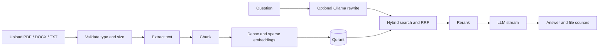

# Doc Intelligence

Doc Intelligence lets users upload PDF, DOCX, and TXT files, ask questions
about their contents, and receive streamed answers with file-level sources.

The backend extracts and chunks documents, indexes them in Qdrant, retrieves
and reranks relevant passages, and sends the resulting context to an LLM.
PostgreSQL stores accounts, document audit records, conversations, and tickets.

## Features

- Validated document uploads, versioned re-uploads, and an audit trail
- Hybrid dense and sparse retrieval, Reciprocal Rank Fusion, and cross-encoder
  reranking
- Streamed Ollama answers with optional query rewriting
- JWT authentication, user-specific conversation history, and Admin/User roles
- Support tickets with Admin review and attachment viewing
- Shared model instances warmed during backend startup
- Jest unit tests and Playwright browser tests

## Requirements

- Docker Desktop (or Docker Engine with Compose)
- Python 3.13 and [uv](https://docs.astral.sh/uv/)
- Node.js 20+ and npm
- [Ollama](https://ollama.com) with the configured chat and rewrite models

## Quick start

### Windows

From the `doc_intelligence` directory, first create `backend/.env` from
`backend/.env.example` and set a strong `SECRET_KEY` and database password.
Then run:

```powershell
.\runWindows.ps1
```

The script starts the backend, PostgreSQL, and Qdrant in Docker and the
Next.js development server. The backend warms its embedding and reranking
models during startup; the API may take several minutes to become ready on a
first run.

### Start services separately

1. Configure the backend:

   ```powershell
   cd doc_intelligence\backend
   Copy-Item .env.example .env
   ```

   Edit `.env` before starting services. Keep the Docker service hostnames in
   the example (`postgres`, `qdrant`) when running the backend in Docker. If
   running the backend directly on your machine, use `localhost` for
   `DATABASE_URL`, `QDRANT_URL`, and `OLLAMA_HOST`.

2. Start the backend and data services. For Docker, from `backend`:

   ```powershell
   docker compose up -d --build
   ```

   Alternatively, start only PostgreSQL and Qdrant in Docker, then run the
   backend on your machine:

   ```powershell
   docker compose up -d postgres qdrant
   uv sync
   uv run python main.py
   ```

3. In a second terminal, start the frontend:

   ```powershell
   cd doc_intelligence\frontend
   Copy-Item .env.example .env.local
   npm ci
   npm run dev
   ```

4. Pull the Ollama models configured in `backend/.env` and
   `frontend/src/app/(protected)/chat/page.tsx`. The defaults are:

   ```powershell
   ollama pull qwen2.5:3b
   ollama pull qwen3.8:27b
   ```

   When the backend runs in Docker and Ollama runs on the host, set
   `OLLAMA_HOST` to `http://host.docker.internal:<port>` (default port
   `11434`). Do not use `127.0.0.1` for the host Ollama server from inside the
   backend container.

Open http://localhost:3000 and register a user. Registration creates a regular
User account. Create the initial Admin using the command in the
[backend guide](doc_intelligence/backend/document/README.md#create-your-first-admin).

## How it works



The embedding, reranker, and sparse embedding models are loaded once per
backend process at startup. Retrieval and query rewriting run off the async
event loop. Ollama serves generation separately from the backend process.

## Configuration

- Backend variables, including JWT, database, CORS, model allowlist, and rate
  limits: [`backend/.env.example`](doc_intelligence/backend/.env.example).
- Frontend API base URL: [`frontend/.env.example`](doc_intelligence/frontend/.env.example).
- Never commit real `.env` or `.env.local` files.

## Repository guides

| Guide | Contents |
|---|---|
| [Backend guide](doc_intelligence/backend/document/README.md) | Backend setup, configuration, API authorization, models, Admin bootstrap, tests, and troubleshooting |
| [Frontend guide](doc_intelligence/frontend/src/documents/README.md) | Frontend setup, routes, API authentication, models, and test commands |
| [CI workflow](.github/workflows/ci.yml) | Backend tests, Jest, Playwright, and Docker image build |

## Current limitations

- Retrieval searches a shared document collection; documents are not isolated
  by user.
- Sources identify files, not the exact supporting chunks, and the app does not
  yet include retrieval evaluation or a confidence threshold.
- The chat UI currently connects to Ollama. OpenAI, Anthropic, and Gemini
  adapters exist, but are not enabled in the UI.
- Model warmup increases backend startup time and memory use.

## License

MIT; see [LICENSE](LICENSE).
