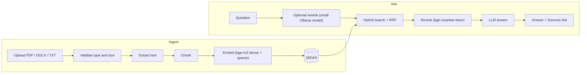

# Doc Intelligence

Ask questions across your own documents and get streamed answers that list the files they came from.

Upload a PDF, DOCX or TXT file → it is chunked and indexed → ask a question in chat → the most relevant chunks are retrieved, reranked and passed to an LLM.

<!-- Add a screenshot or short GIF of the chat page here: docs/images/demo.gif -->

## Features

- **Ingestion** with file-type and size validation, versioned re-uploads (old vectors are removed), and an audit trail
- **Hybrid retrieval**: dense + sparse vectors fused with Reciprocal Rank Fusion, then cross-encoder reranking
- **Streaming answers** from a local Ollama model, with an optional query-rewrite step
- **Conversation history**, JWT login, Admin/User roles, and a support-ticket workflow
- **Provider adapters** for OpenAI, Anthropic and Gemini (currently disabled in the UI, see [Status](#status-and-limitations))

## Quick start

You need Docker, [uv](https://docs.astral.sh/uv/), Node 20+, and [Ollama](https://ollama.com).

for unified run
```bash
 .\runWindows.ps1
```
for seperate

```bash
# 1. Infrastructure and backend
cd doc_intelligence/backend
cp .env.example .env            # then edit it; see backend/README.md for host-mode values
docker compose up -d postgres qdrant
uv sync
uv run python main.py           # API on http://localhost:8000

# 2. Frontend (new terminal)
cd doc_intelligence/frontend
npm ci
npm run dev                     # app on http://localhost:3000

# 3. Models (new terminal)
ollama pull qwen2.5:3b          # query rewriting
ollama pull qwen3.8:27b         # default chat model (or change it in the frontend)
```

Open http://localhost:3000, register an account, then promote it to Admin so you can upload and delete documents. The steps are in [backend/README.md](doc_intelligence/backend/README.md#create-your-first-admin).

On Windows, `doc_intelligence/runWindows.ps1` starts the Docker services and the frontend together (run it from the `doc_intelligence` folder).

## How it works



Qdrant holds the vectors. PostgreSQL holds users, document audit records, conversations and tickets.

## Repository layout

| Path | Contents |
|---|---|
| [`doc_intelligence/backend`](doc_intelligence/backend/README.md) | FastAPI app, RAG pipeline, pytest suite, Docker Compose |
| [`doc_intelligence/frontend`](doc_intelligence/frontend/README.md) | Next.js app, Jest and Playwright tests |
| `.github/workflows/ci.yml` | Backend tests, Jest, Playwright, Docker image build |

## Stack

FastAPI · Next.js 16 / React 19 · Qdrant · PostgreSQL 16 · Sentence Transformers (`BAAI/bge-m3`, `BAAI/bge-reranker-base`) · fastembed · Ollama

## Status and limitations

This is a working demo and learning project, not a hardened product. Known gaps:

- **Auth is partial.** Only admin routes check the JWT. Upload, file listing, chat, chat history and ticket routes are open, and the chat endpoint trusts the `username` in the request body.
- **Performance.** The embedding and reranker models are loaded on every request instead of once at startup.
- **Single shared collection.** Every user searches the same documents.
- **Citations are file-level.** Answers end with a `Sources:` line naming files; they are not verified against the answer text, and there is no "not found in the documents" fallback.
- **Other LLM providers.** OpenAI, Anthropic and Gemini are blocked in the chat UI and have not been verified end to end.
- **No retrieval evaluation** yet.
- The frontend has the API URL (`http://localhost:8000`) hardcoded.

## Roadmap

- [ ] Auth on every data route; derive the user from the token
- [ ] Load models once at startup
- [ ] Retrieval relevance threshold and a "not found" answer
- [ ] Chunk-level citations
- [ ] Retrieval evaluation set
- [ ] API URL via environment variable
- [ ] Rate limiting and caching

## License

MIT, see [LICENSE](LICENSE).